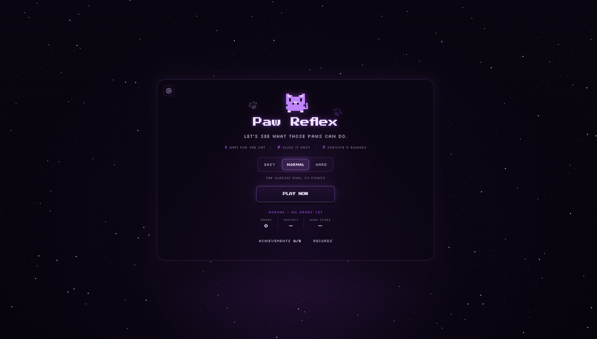
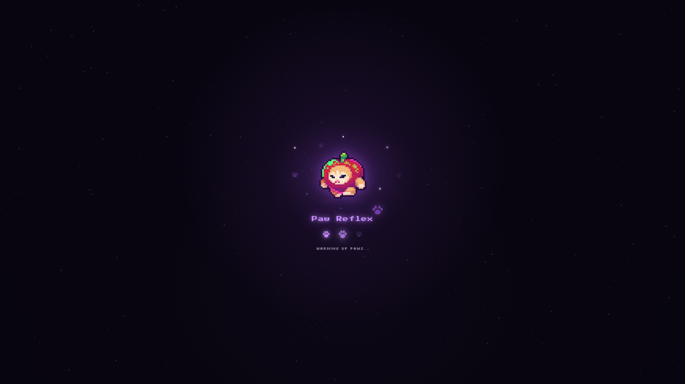
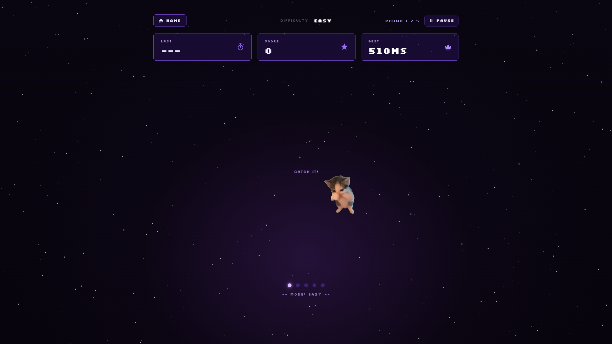
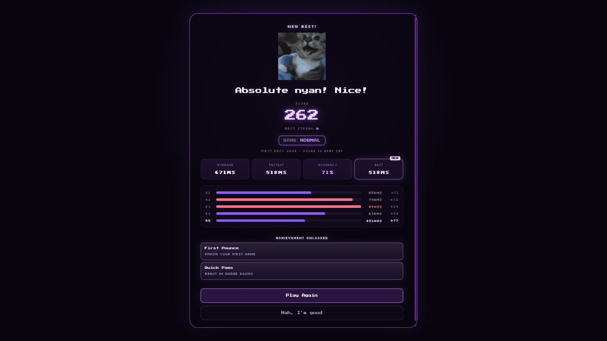

# 🐾 Paw Reflex

### A Pixel-Art Reaction Time Game

Test your reflexes. Chase the cat. Beat your best.

---

## 🎮 About the Game

**Paw Reflex** is a browser-based reaction-time game featuring pixel-art visuals, an animated cat, and progressively challenging rounds.

Wait for the cat to appear, click as quickly as possible, build combos, unlock achievements, and challenge your personal records.

> 🐱 Five rounds. Three difficulty modes. One goal: beat your best reaction time.

## 📸 Screenshots

### 🏠 Home Screen

### ⏳ Loading Screen

### 🎯 Gameplay

### 🏆 Results

---

## ✨ Features

| Feature | Description |
|:---|:---|
| 🎯 **5 Rounds** | Complete five rounds of reaction challenges. |
| ⚡ **3 Difficulty Modes** | Choose Easy, Normal, or Hard. |
| 🔥 **Combo Multipliers** | Build combos and increase your score. |
| 📊 **Detailed Statistics** | Track average time, fastest reaction, accuracy, and best streak. |
| 🏅 **8 Achievements** | Unlock achievements through gameplay. |
| 💾 **Personal Records** | Save your statistics in browser Local Storage. |
| ⏸️ **Pause Menu** | Pause, restart, or quit a game. |
| ⚙️ **Customizable Settings** | Control music, sound effects, and visual effects. |
| 🎨 **Pixel-Art Visuals** | Enjoy pixel-inspired graphics and animated screens. |
| 🎵 **Background Music** | Listen to music on the home screen. |

---

## 🕹️ How to Play

1. Choose a difficulty: **Easy, Normal, or Hard**.
2. Click **Play Now** to begin.
3. Click **Start the Round** and wait for the cat.
4. Click the cat as quickly as possible.
5. Avoid clicking too early, as it counts as a miss.
6. Complete all five rounds and review your results.

**Controls**

| Key / Action | Function |
|:---|:---|
| Mouse click | Hit the cat |
| `Esc` | Pause or resume |

---

## 🛠️ Tech Stack

| Technology | Purpose |
|:---:|:---|
|  | Structure |
|  | Styling and animations |
|  | Game logic and interactions |
| **Local Storage** | Persistent player statistics |

No external frameworks or libraries were used.

---

## 👨‍💻 About the Developer

Hi! I'm **Renzo Cabaya**, a BSIT student specializing in Web Development with the goal of becoming a Software Engineer.

I built Paw Reflex to practice and strengthen my skills in:

- Front-end web development
- JavaScript and DOM manipulation
- Game logic and event handling
- Interactive user interface design
- Browser Local Storage

I'm continuously learning, building projects, and improving my development skills.

---

## 🎨 Credits & Attributions

This project uses third-party assets that belong to their respective creators.

| Asset | Credit |
|:---|:---|
| Apple Cat Loading GIF | [@llla_gal on GIPHY](https://giphy.com/llla_gal/) |
| Home Screen Music | [Original track on YouTube](https://youtu.be/0QgRku9uvn8?si=h84uKzotMyEU8fJY) |

All rights to third-party assets remain with their respective creators.

---

**🐾 Thanks for checking out Paw Reflex!**

Built with HTML, CSS, and JavaScript by Renzo Cabaya.

